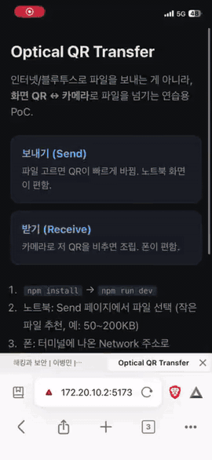

# Optical QR Transfer

빛과 카메라 만으로 (인터넷 사용 없이) 파일 전송 프로그램

| 분류 | 상태 | 스택 | 바로 보기 |
| --- | --- | --- | --- |
| 에어갭 · 도구 | 완료 | JavaScript · Vite · QR | [시연 GIF](#시연) |

Wi‑Fi/BT로 파일을 보내는 게 아니라, 한쪽이 QR을 돌리고 다른 쪽이 카메라로 읽음.
[decimen-optical-transfer](https://github.com/bashalarmistalt/decimen-optical-transfer/) 보고 단순하게 만들어 봄.
(원본은 fountain code, 여기는 조각 나눠서 루프)

---

## 시연



[X에서 보기](https://x.com/youngchanl6152/status/2083451192345272745)

---

## 실행

```bash
npm install
npm run dev
```

1. **노트북** `https://localhost:5173/send/` — 파일 고르고 전송
2. **폰** 같은 Wi‑Fi/핫스팟에서 `https://(노트북IP):5173/receive/`
3. HTTPS 경고 뜨면 고급 → 계속 방문
4. 폰 카메라 켠 다음 노트북 QR 비추기

---

## 구조

```
send/      QR 송출
receive/   카메라 수신
shared/    META|… / DATA|… 포맷
media/     시연 GIF
```

## 한계

느리고 큰 파일은 비추. 학습·데모용.
페이지 처음 열 때는 개발 서버 접속이 필요하고, 파일 데이터 자체는 빛으로만 감.

---

**관련 저장소** · [aegis-cortex](https://github.com/JimProKing/aegis-cortex) · [aegis-protocol](https://github.com/JimProKing/aegis-protocol)

<sub>[JimProKing](https://github.com/JimProKing) · 이영찬 — 전체 저장소는 프로필의 프로젝트 지도에서 분야별로 볼 수 있습니다.</sub>
<!-- jpk-footer -->
